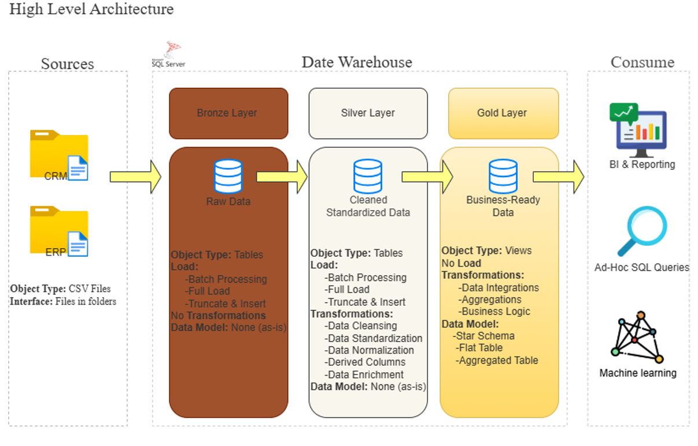

# sql_data_warehouse_project

Building a modern data warehouse with SQL Server, including ETL, data modeling, and analytics.

## Architecture

The warehouse loads CRM and ERP CSV files through three layers:

- **Bronze:** raw data, loaded as-is
- **Silver:** cleaned and standardized data
- **Gold:** business-ready star schema for reporting, ad-hoc queries, and machine learning

